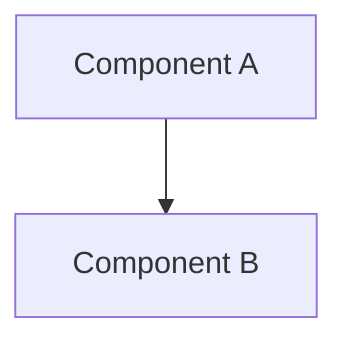

# Architecture — aws-infra

_Last updated: 2026-10-19_

## Overview
<!-- 2–3 sentences: what the system does end to end. -->

## Components
<!-- One bullet per component: what it is, where it runs, what it's responsible for. -->
- **<component>** (`<address or namespace>`) — responsibility.

## Diagram

## Data flows
<!-- Numbered path of one real request or change through the system. -->
1.
2.

## Trust boundaries
<!-- Where data or control crosses from one trust level to another
     (internet → lab, CI → registry, cluster → cloud). Each one appears in the
     threat model. -->
| Boundary | Crosses from → to | Protected by |
|---|---|---|
| | | |
